<p align="center">
  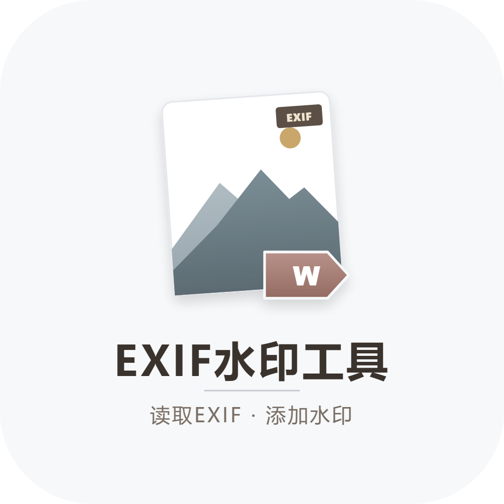<br>
</p>

<H1 align="center"><sub>「镶 · 水印」 水印处理工具</sub></H1>
<p align="center"><sub>一帧入画　一镶成框</sub></p>

> - 为您的照片嵌入专业相机参数水印。
> - 自动读取 EXIF，为照片生成品牌、型号、快门、光圈、ISO 参数水印；支持多种布局与多种画幅比例组合；背景、投影、字体等多种选项可调，支持单张与目录批量处理，全程本地运行。
> - 基于 **Python + PySide6（Qt 6）** 的原生桌面应用。
> - 新增支持**cli模式**，支持**Agent客户端调用skill**出图。

---

<br>

## 程序界面 & 效果示例

### 程序界面

<p align="center">
  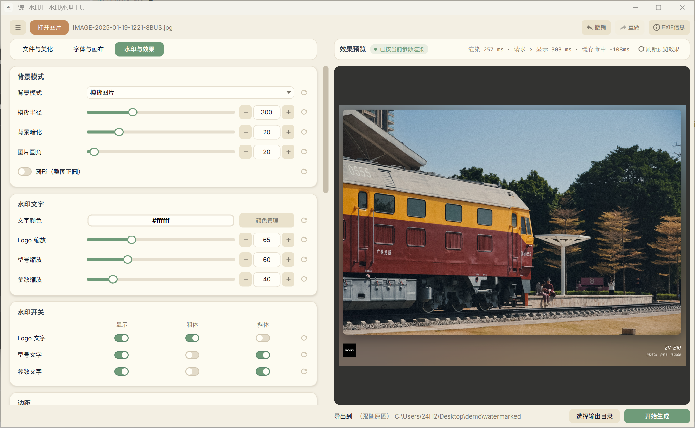
</p>

### 水印效果

<table align="center" border="0" cellspacing="12">
  <tr>
    <td align="center" width="30%"></td>
    <td align="center" width="30%">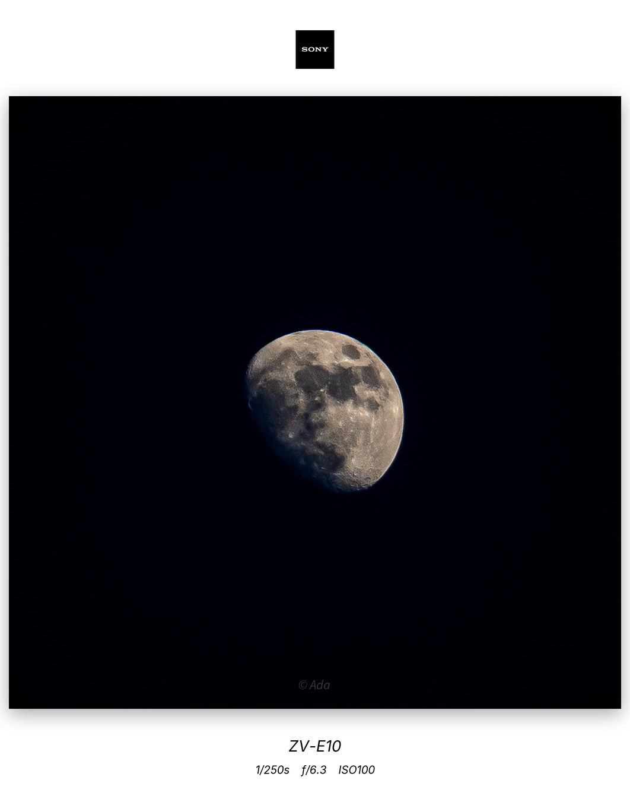</td>
    <td align="center" width="30%">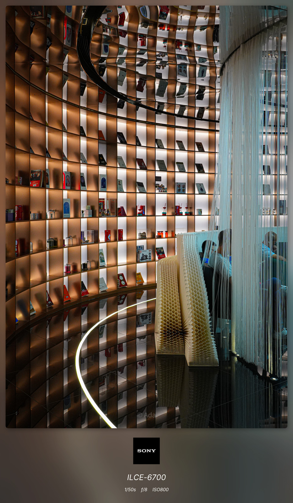</td>
  </tr>
</table>
<br>

<details>
  <summary style="cursor: pointer;" align="center">点击展开查看更多示例（多图预警）</summary>
  <br>

 <table align="center">
    <tr>
        <td align="center" width="45%">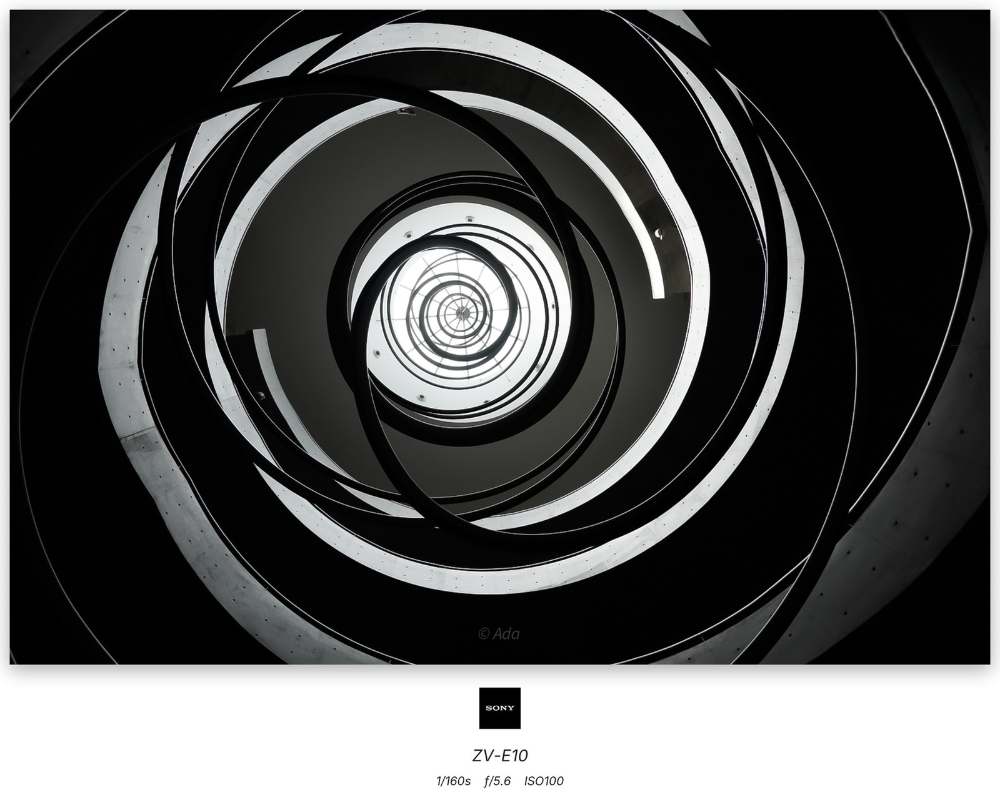</td>
        <td align="center" width="45%">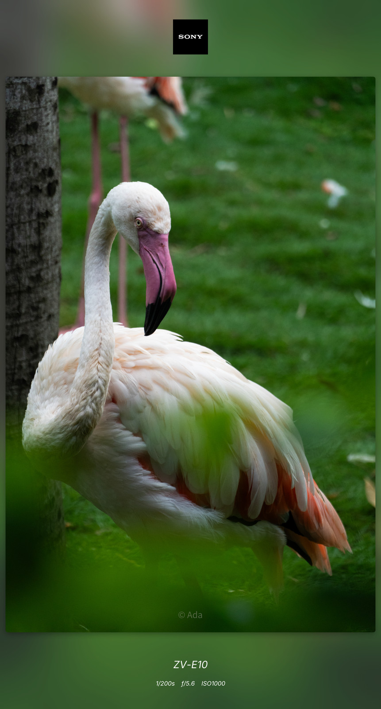</td>
    </tr>
    <tr>
      <td align="center" width="45%">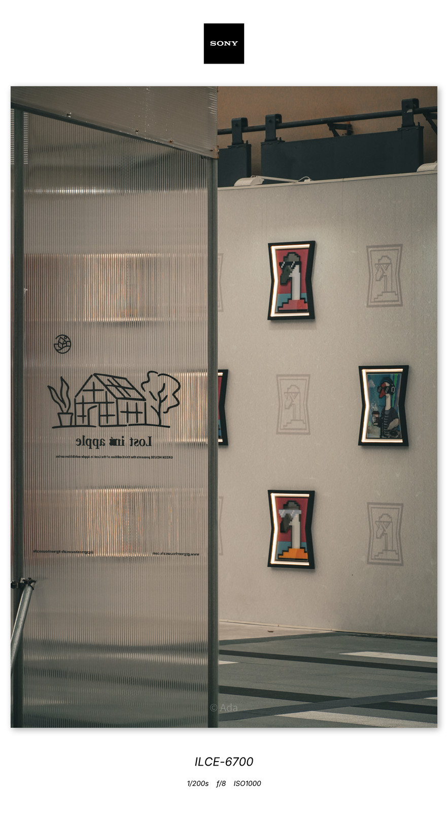</td>
      <td align="center" width="45%"></td>
    </tr>
    <tr>
      <td align="center" width="45%"></td>
      <td align="center" width="45%">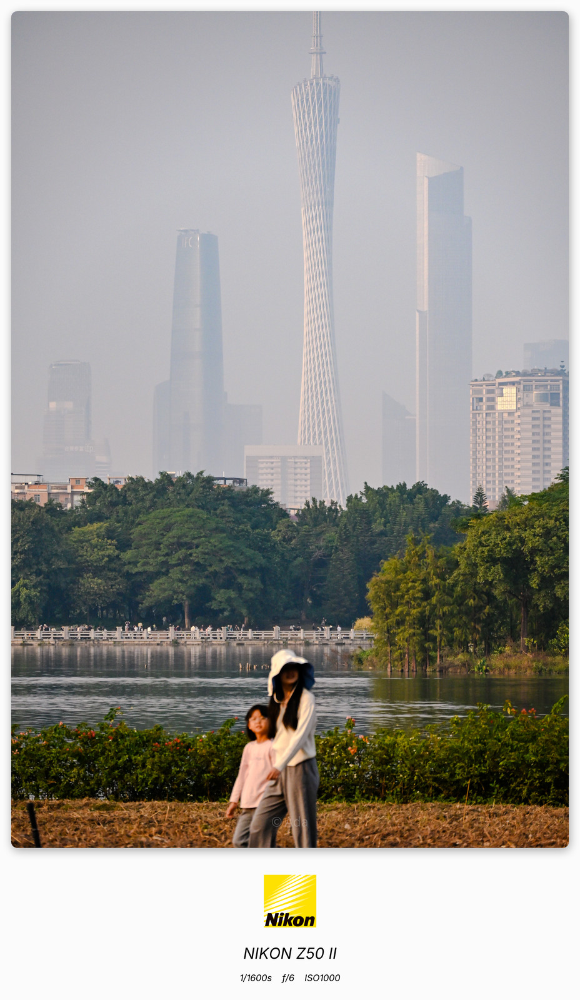</td>
    </tr>
    <tr>
      <td align="center" width="45%"></td>
      <td align="center" width="45%">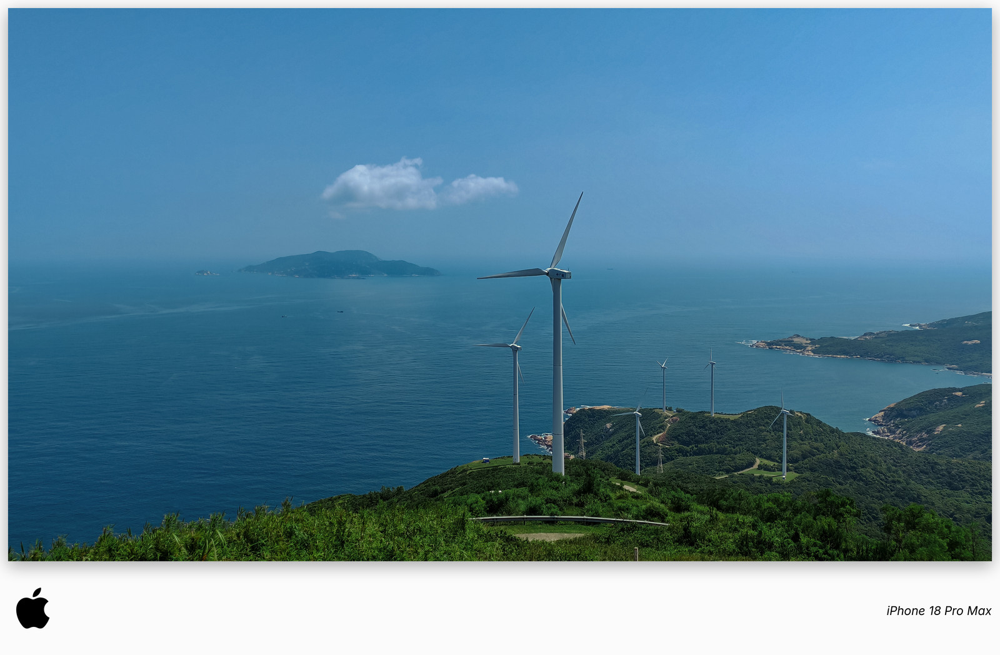</td>
    </tr>
    <tr>
      <td align="center" width="45%"></td>
      <td align="center" width="45%">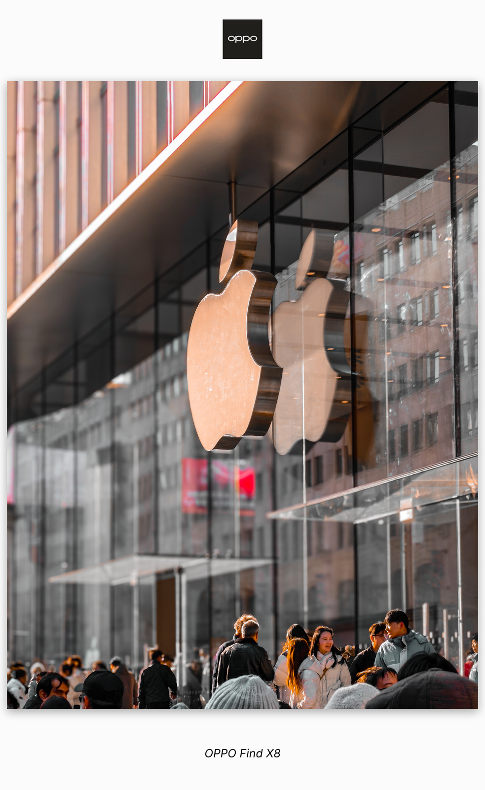</td>
    </tr>
  </table>
</details>

---

<br>

## 下载与使用

### 🚀 推荐方式：直接下载可执行文件（Windows）

- **推荐直接下载已编译好的 exe 文件**，无需安装 Python 环境以及依赖，**纯绿色免安装版（纯解压、无残留、免管理员、不写注册表）**。

1. 前往 [Releases 页面](https://github.com/DXVE/xiang-shuiyin/releases)
2. 选择最新版本
3. 下载编译好的文件：**`xiangshuiyin-<版本号>-portable.exe`**
4. 双击安装解压后即可运行

- 也可以选择自行构建（构建机需装 Inno Setup，它只作构建工具、不随产物分发）：

```bat
uv sync
:: 1) 目录形态载荷（同时生成版本头文件）
set XSY_ONEDIR=1 && uv run pyinstaller packaging\xiangshuiyin-qt.spec
:: 2) 编译安装器
ISCC.exe packaging\xiangshuiyin-qt.iss
```

产物是 `dist\xiangshuiyin-v<版本号>-portable.exe`（`<版本号>` 取自 `src/core/__init__.py`）：双击安装解压后即可运行，**自动创建桌面快捷方式**。

> ⚠️ **关于杀毒软件误报**：自行打包的 exe 可能被部分杀毒软件（如 Windows Defender）误报为病毒，属于**误报**而非真正的恶意程序。程序由本仓库公开源码编译，可自行核对后放心使用。若被拦截，可以选择：
> 1. 直接在资源管理器中放行该文件；
> 2. 或对该文件所在目录添加信任／排除项。

---

### 🐍 从源码运行（开发者）

#### 环境要求

- Python 3.10+
- [uv](https://docs.astral.sh/uv/)：按 `.python-version` 准备解释器，依赖锁定在 `uv.lock`
- 运行平台：**Windows** 为当前主要验证平台，打包配置也面向 Windows；界面与内核基于跨平台 Qt 与 Pillow，macOS / Linux 上可运行，但未做打包与完整验证。各平台的功能点差异、成因与影响见 [`docs/跨平台功能点差异.md`](docs/跨平台功能点差异.md)。

#### 安装依赖

```bash
uv sync
```

> `uv sync` 按 `pyproject.toml` 与 `uv.lock` 创建仓库内 `.venv` 并装好运行依赖；PyInstaller 在 dev 组，默认一并安装，用于本地打包。

#### 运行

```bat
uv run python main.py
```

> 启动后即打开应用窗口。**首次运行会在用户数据目录里创建配置目录与内置字体的持久副本。**

### 快速上手

1. 拖入图片，或点击「打开图片」（拖入多张或一个目录即为批量）
2. 对照预览，调整属于自己的水印风格
3. 点击「开始生成」，等待完成即可

---

<br>

## 🎨 功能概览

| 模块 | 说明 |
|---|---|
| [输入与批处理](#-1-输入与批处理) | 支持拖放选择图片/目录；支持单张，或目录批量处理（可含子文件夹） |
| [EXIF 参数水印](#-2-exif-参数水印) | 自动读取品牌、型号、快门、光圈、ISO；也可手动填写覆盖；顶栏可查看照片原始 EXIF |
| [Logo 图片与型号美化](#️-3-logo-图片与型号美化) | 按 EXIF 品牌自动匹配 Logo；支持型号映射美化显示（如 `Z50_2` → `Z50 II`） |
| [画布与布局](#-4-画布比例-与-水印布局) | 支持 跟随原图 或 9个标准比例；三种水印布局；元素边距可调并支持悬停高亮显示 |
| [背景与主体](#-5-背景样式) | 支持 模糊背景 / 纯色背景；支持圆角 或 正圆裁剪 |
| [描边与投影](#️-6-描边与投影) | 三组水印文字独立开关与缩放；支持文字 / 图片描边与投影 |
| [预设与配色](#-7-预设与配色) | 10 个预设槽位，可导入导出分享；内置预设颜色，支持颜色收藏 |
| [预览与撤销](#-8-预览与撤销) | 改动参数实时预览，支持放大镜预览细节；支持撤销 / 重做 |
| [其它](#配置目录) | 内置字体、中英双语支持、单实例、独立日志（保留 3 份） |

---

<br>

## 功能详解

### 📥 1. 输入与批处理

- **支持的格式**：`.jpg`、`.jpeg`、`.png`、`.webp`、`.gif`、`.bmp`、`.tif`、`.tiff`、`.ico`。
- **单张**：**选择或拖入一张图片**后开始。
- **批量**：**一次拖入多张图片、或直接拖入一个文件夹（可含子文件夹）**后开始，每张图片串行处理，会自动创建子文件夹，不会和单张成品混在一起。
- **导出目录**：由底栏的「选择输出目录」指定；批量会在其下再建时间戳子目录，生成结束后自动打开输出目录。

> 输出名统一为 `<原文件名>_watermarked.jpg`；同一批里出现重名时自动加序号，不会互相覆盖。

<br>

### 📷 2. EXIF 参数水印

- **EXIF 水印**：工具自动读取照片的 EXIF 元数据，生成专业的相机参数栏：

| 参数 | 来源 | 示例 |
|---|---|---|
| 品牌 | `Image Make` | `NIKON` |
| 型号 | `Image Model` | `Z50_2` |
| 快门 | `ShutterSpeedValue` / `ExposureTime` | `1/125s` |
| 光圈 | `FNumber` | `f/4.0` |
| ISO | `ISOSpeedRatings` | `ISO 400` |

- **自定义水印**：启用「自定义水印信息」后可手动填写品牌、型号、快门、光圈、ISO，**勾选后将强制使用自定义内容**，覆盖自动读取的 EXIF 数据。
- **照片信息查看**：点击顶栏「EXIF信息」显示文件信息与照片 EXIF 信息。

<br>

### 🏷️ 3. Logo 图片与型号美化

- **Logo 匹配**：将品牌 Logo 放入数据目录下的 `logos\`（Windows 下为 `%LOCALAPPDATA%\XiangShuiyin-QT6\watermark_data\logos\`），工具根据 EXIF 品牌自动匹配：**文件名包含品牌名**，不区分大小写、忽略空格，（如 `nikon.png` 自动匹配 `NIKON CORPORATION`）。

- **型号美化**：将设备原始型号映射为**自定义显示名称**（如 `NIKON Z50_2` 映射为 `NIKON Z50 II`）；程序通过 `model_map.json` 自定义映射表，也可以在「型号映射管理」弹窗中进行增加 / 修改 / 删除。

<br>

### 📐 4. 画布比例 与 水印布局

- **画布比例**：输出图片宽高比灵活调整——跟随原图，或从 1:1 / 3:2 / 2:3 / 4:3 / 3:4 / 16:9 / 9:16 / 21:9 / 9:21 共 9 个标准档位中选择。
- **水印布局**：三种排布方式：

| 模式 | 效果 |
|---|---|
| **统一下方** | 所有信息统一排列在图片底部 |
| **上下分离** | 品牌在上，型号 + 参数在下 |
| **下方左右分离** | 品牌靠左，型号 + 参数靠右 |

- **对比模式**（布局下方的开关）：开启后同一张图按上面三种布局各出一张，其余参数完全一致，便于挑出最合适的一种；文件名带布局后缀区分。预览仍按当前选中的布局显示。

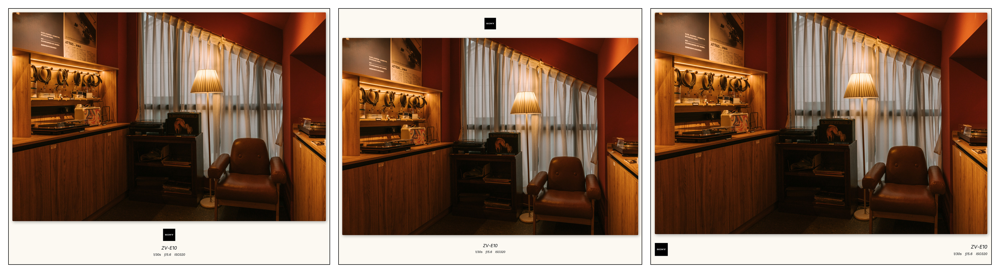

<br>

### 🎨 5. 背景样式

| 模式 | 效果 |
|---|---|
| **纯色背景** | 自定义背景颜色 |
| **模糊背景** | 高斯模糊，半径 1~1000 可调，可选背景暗化 |

> - 图片支持**圆角裁剪**（半径 0~1000 可调），也支持勾选`圆形`把主体裁为**正圆**。
> - 颜色选择对话框由「当前颜色 + 预设色 + 我的颜色」三部分组成，选中的颜色即时应用；支持最多10中自定义**颜色收藏**，收藏的颜色随设置文件保存，跨会话复用。

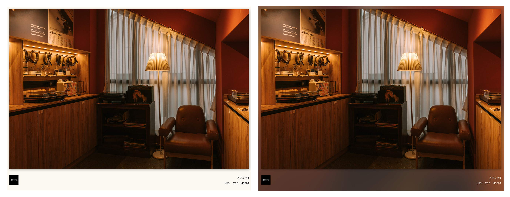

<br>

### ✏️ 6. 描边与投影


- **文字描边**：自定义描边颜色与宽度（1~50），在深色/浅色背景上都能清晰可读。
- **图片描边**：为图片添加外轮廓描边，复杂背景上也能清晰勾勒。

<br>

- **文字投影**：文字沿指定方向偏移生成投影，经高斯模糊得到柔和边缘。
- **图片投影**：生成向外晕开的半透明阴影（类似水墨在宣纸上散开），角度可调、边缘柔和，不遮挡水印文字。

<br>

### 💾 7. 预设与配色

- **预设系统**：10 个槽位，存放在数据目录的 `presets\` 下（`presets1.json` ~ `presets10.json`）。可**保存 / 加载不同风格配置**，一键切换。支持导入 / 导出单个方案文件，方便分享属于自己的水印预设。
- **颜色选择**：统一的取色弹窗由「当前颜色 + 预设色 + 我的颜色」三部分组成，选中的颜色即时应用到预览。
- **颜色收藏**：自定义颜色可收藏保存，**上限 10 个**；收藏内容随设置文件一起保存，跨会话复用，重启程序后仍在。

<br>

### 👁 8. 预览与撤销

- **实时效果预览**：改动任一参数后自动重新渲染并显示。
- **放大镜**：鼠标悬停在预览图上时，预览框一角会跟着光标显示局部放大画面，方便核对水印细节。
- **边距高亮预览**：调节边距滑块时，**鼠标悬停在控件上**，右侧预览图会自动高亮对应的间距色带，直观看到当前调整的边距距离。
- **撤销 / 重做**：`Ctrl+Z` 撤销、`Ctrl+Shift+Z`（或 `Ctrl+Y`）重做，最多回退 **100 步**。

---

<br>

## 常见问题（FAQ）

### Q1：提示「无法读取 EXIF」怎么办？

部分手机截图、社交平台下载的图片可能不包含标准 EXIF。可以：

1. 启用「自定义水印信息」手动填入品牌、型号、快门、光圈、ISO（单张与批量都会生效）
2. 用顶栏「EXIF信息」确认图片里到底存了什么（它显示的是照片原始读数，不做推算）

### Q2：如何添加自己品牌的 Logo？匹配规则是什么？

将 Logo 图片放入 Logo 目录（Windows 为 `%LOCALAPPDATA%\XiangShuiyin-QT6\watermark_data\logos\`），**文件名需包含对应品牌名**（不区分大小写，如 `NIKON_logo.png`），工具会自动匹配；同一品牌命中多个文件时取文件名最短的那个。Logo 目录的位置固定，界面上不可配置；目录不存在时，「打开 Logo 目录」会先创建再打开。

### Q3：预设方案保存在哪里？

预设保存在数据目录的 `presets\` 下，**一槽一个文件**：`presets1.json` ~ `presets10.json`（Windows 为 `%LOCALAPPDATA%\XiangShuiyin-QT6\watermark_data\presets\`，其它平台见「配置目录」），共 **10 个槽位**，可分别保存不同的水印风格配置。文件名只承载槽位号，预设名存在文件内容里，因此不受非法字符、重名与超长的影响；手工往该目录放一个 `presets5.json`，不重启也能在弹窗里看到。

---

<br>

## 配置目录

所有配置与数据都存放在用户数据目录下的 `XiangShuiyin-QT6\`（Windows 为 `%LOCALAPPDATA%\`；macOS / Linux 走各自惯例的数据目录）：

```
XiangShuiyin-QT6\
├── watermark_data\
│   ├── settings.json          # 参数 + 收藏颜色 + 处理模式（原子写入、合并保存）
│   ├── presets\               # 预设：一槽一个文件，共 10 槽
│   │   ├── presets1.json
│   │   └── ...
│   ├── logos\                 # Logo 图片库（界面不可配置，位置固定）
│   │   ├── nikon.png
│   │   └── model_map.json     # 型号映射表
│   └── fonts\
│       └── bundled\           # 内置字体的持久副本（首次运行自动写入，按文件大小同步）
└── logs\
    ├── log-20260924_221920.log   # 每次启动一份，自动保留最近 3 份
    └── ...
```

预览用的缩略图写在系统临时目录下的本程序专有目录里，**程序退出时整目录清空**，不占用数据目录。

---

<br>

## 免责声明与许可证

本项目为个人学习作品，部分代码与文档由 AI 辅助生成，无法完整追溯该部分内容的来源，代码质量未经严格测试，不提供任何明示或暗示的保证，**不建议在生产环境或未备份的重要数据上使用**。使用前请务必备份原始数据，作者不对因使用本工具造成的任何数据丢失或损坏承担责任。

本项目采用 [MIT License](LICENSE)（许可声明同时写在 `pyproject.toml` 的 `license` 字段里）；MIT 许可仅就作者自身拥有权利的部分作出授权，作者不对 AI 生成部分的原创性、不侵权性作任何明示或暗示的主张或保证，使用者应自行评估并承担由此产生的风险。

本程序在运行与打包分发时包含 [Pillow](https://python-pillow.org)（MIT-CMU）、[exifread](https://github.com/ianare/exif-py)（BSD-3-Clause）、[PySide6](https://www.qt.io/qt-for-python) / Qt（LGPLv3，运行期只用到 Essentials 范围内的模块）、Python 运行时（PSF-2.0）与 Sarasa Gothic 字体（SIL OFL 1.1）；打包产物里还含 PyInstaller 的引导程序（嵌入主程序）、Inno Setup 的安装引导程序（嵌入安装器）与 Windows 运行库。各组件的版权声明、许可与随包义务见 [THIRD_PARTY_LICENSES.md](THIRD_PARTY_LICENSES.md)；字体的许可全文与来源改动记录已随包分发在 `src/assets/fonts/OFL.txt` 与 `NOTICE.txt`。

**对外分发时**请把 `LICENSE`、`THIRD_PARTY_LICENSES.md` 与 `licenses/` 目录一起带上：打包脚本会在构建结束后把它们复制进产物，并随安装器装进程序目录，因此分发的安装器里已经包含这些文本。`licenses/` 里是各组件的许可全文：PySide6 / Qt 走 LGPLv3，因此同时附 **GPLv3 与 LGPLv3 全文**，并在 `licenses/Qt-Notice.txt` 里写明所用版本、源码位置与「可替换」说明；清单与义务说明见 `THIRD_PARTY_LICENSES.md`。

---

<br>

## 素材声明

- **示例照片**：本仓库中所有示例照片均为作者本人拍摄，版权归作者所有。
- **品牌 Logo**：本仓库示例照片中使用的厂商 Logo 来源于互联网，版权归各自品牌方所有。仅用于水印展示功能，如有侵权请联系删除。

---

<br>

## 开发说明与致谢

- 本项目采用 Vibe Coding 方式开发，部分内容及代码由 AI 辅助生成，请注意甄别。
- 开发过程中使用的模型（排名不分先后）：[DeepSeek](https://www.deepseek.com/)、[GLM](https://open.bigmodel.cn/)、[MiniMax](https://minimax.cn/)、[Kimi](https://www.kimi.com/)。
- 开发过程中使用的 Agent 工具（排名不分先后）：[ZCode](https://zcode.z.ai/cn)、[Cherry Studio](https://github.com/CherryHQ/cherry-studio)、[MiniMax Code](https://agent.minimax.cn/)、[Pi Agent](https://github.com/earendil-works/pi)、[DeepSeek Harness](https://www.deepseek.com/harness/)。
- 感谢上述模型与工具提供方，以及所有开源项目与贡献者。
